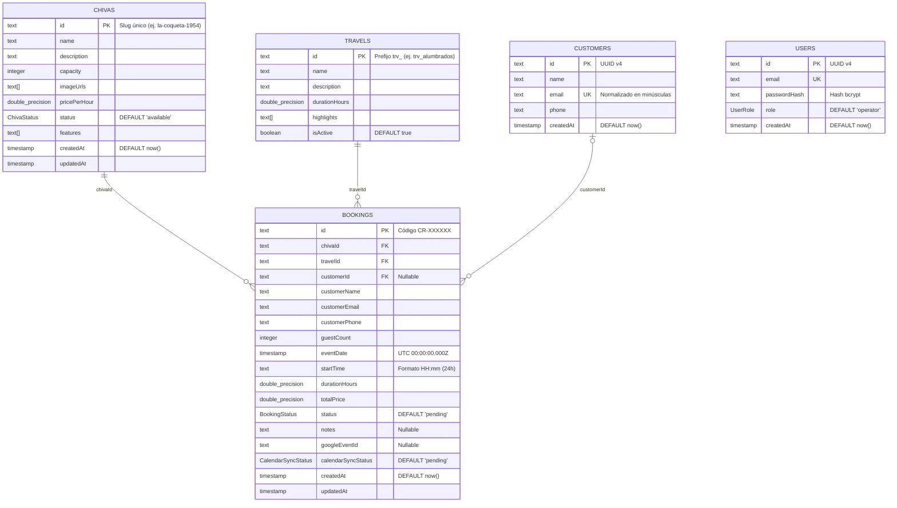

# Modelo de Datos y Reglas de Negocio (Fase 1)

Este documento describe el esquema físico de PostgreSQL (definido en `backend-express/prisma/schema.prisma`), los enumerados, los Value Objects y las reglas de dominio que deben cumplirse de forma idéntica en **Express**, **Java (Spring Boot)** y **Scala 3 (http4s)**.

---

## 1. Diagrama Entidad-Relación (PostgreSQL)

---

## 2. Enumerados de Base de Datos

| Enum PostgreSQL | Valores permitidos | Uso |
| :--- | :--- | :--- |
| `ChivaStatus` | `available`, `maintenance`, `retired` | Estado operativo de una chiva (`chivas.status`). |
| `BookingStatus` | `pending`, `confirmed`, `cancelled`, `completed` | Ciclo de vida de una reserva (`bookings.status`). |
| `CalendarSyncStatus` | `pending`, `synced`, `failed` | Estado de sincronización con Google Calendar (`bookings.calendarSyncStatus`). |
| `UserRole` | `admin`, `operator` | Rol de autorización en el JWT y tabla `users` (`users.role`). |

---

## 3. Reglas de Dominio, Value Objects y Generadores

### 3.1. Generación de Identificadores
- **Código de Reserva (`Booking.id`)**: Prefijo `CR-` seguido de 6 caracteres alfanuméricos sin caracteres ambiguos (`23456789ABCDEFGHJKLMNPQRSTUVWXYZ`), p. ej. `CR-8P2Q9M`.
- **Slug de Chiva (`Chiva.id`)**: `slugify(name)` (minúsculas, sin tildes/diacríticos NFD, caracteres no alfanuméricos reemplazados por `-`). Si ya existe en BD, se añade sufijo incremental `-2`, `-3`, etc.
- **Cliente (`Customer.id`) y Usuario (`User.id`)**: UUID v4 estándar.

### 3.2. Value Objects y Validaciones
1. **`TimeSlot(startTime, durationHours)`**:
   - `startTime`: Formato 24h `^([01]\d|2[0-3]):([0-5]\d)$`. Si no cumple → `ValidationError` (`400`).
   - `durationHours`: Número entre `1` y `12` inclusive (`1 <= durationHours <= 12`). Si no cumple → `ValidationError` (`400`).
   - `getEndTime()`: Suma `durationHours * 60` a `startTime` y aplica módulo 24h en formato `HH:mm`.
   - `overlapsWith(other)`: Dos bloques `[startA, endA)` y `[startB, endB)` en minutos desde medianoche se solapan si y solo si `startA < endB && startB < endA`.
2. **`EventDate(date, startTime)`**:
   - Debe tener formato `YYYY-MM-DD`. Se almacena como `YYYY-MM-DDT00:00:00.000Z`.
   - **Anticipación mínima de 24 horas**: Se evalúa el instante `${rawStr}T${timePart}:00-05:00` (zona `America/Bogota`). Si `eventMomentBogota.getTime() - now.getTime() < 24 * 60 * 60 * 1000`, lanza `ValidationError` (`400`).
3. **`GuestCount(count, chivaCapacity)`**:
   - Entero `>= 1` y `<= chiva.capacity`. Si no cumple → `ValidationError` (`400`).

### 3.3. Reglas de Ciclo de Vida de Reservas
- **Autocompletado por fecha/hora cumplida (`completeElapsedConfirmedBookings`)**:
  - Antes de consultar reservas (`findBookingById`, `findBookingAll`, `findBookingPaginated`, `findConfirmedByDateRange`, `hasFutureActiveBookingsByChiva`), todas las reservas en estado `confirmed` cuyo instante `${YYYY-MM-DD}T${startTime}:00-05:00` sea `<= now` pasan automáticamente a `completed`.
- **Transiciones válidas en `PATCH /bookings/:id/status`**:
  - `pending` → `confirmed` | `cancelled`
  - `confirmed` → `completed` | `cancelled`
  - `cancelled` → *(ninguna)*
  - `completed` → *(ninguna)*
  - Cualquier otra transición de estado lanza `InvalidBookingStatusTransitionError` (`422`), salvo cuando se envía `totalPrice` / `price` manteniendo el mismo estado actual (`isSameStatusPriceUpdate`), lo cual permite actualizar el precio acordado (`Math.round(customTotalPrice)`).
- **Upsert de `Customer` al crear reserva (`POST /bookings`)**:
  - Se normaliza `customerEmail` con `.trim().toLowerCase()`.
  - Si existe un `Customer` con ese correo, se actualizan `name` y `phone` y se reutiliza su `id`; si no existe, se crea.
  - `totalPrice` inicial se calcula como `chiva.pricePerHour * durationHours`.

---

## 4. Aplicación de Programación Funcional en los Tres Backends

Siguiendo el **Requisito 2** y la **Regla 2** (sin inventar endpoints), los tres backends implementan con colecciones inmutables y funciones de orden superior (`filter`, `map`, `groupBy`, `reduce`/`foldLeft`, `sortBy`) la lógica de negocio de los endpoints del dashboard y calendario:

1. **`GET /bookings/calendar?month=YYYY-MM` (Dashboard Admin — Calendario Mensual)**:
   - **`filter`**: Filtra reservas con `status === "confirmed"` cuya fecha formateada en `America/Bogota` comience con `YYYY-MM`.
   - **`groupBy` (nivel 1 — por día `YYYY-MM-DD`)**: Agrupa las reservas confirmadas del mes por fecha del evento.
   - **`groupBy` (nivel 2 — por `chivaId` dentro de cada día)**: Agrupa las reservas de cada día por chiva y proyecta (`map`) cada reserva a `CalendarSlotDto` calculando `endTime` y `endsNextDay` (`totalMinutes > 1440`).
   - **`sortBy` + `map`**: Ordena los slots por `startTime` ascendente, construye `CalendarDayChivaDto` y `CalendarDayDto` (con `chivasCount`), ordena los días cronológicamente y extrae el catálogo único de `chivas` presentes en el mes.
2. **`GET /bookings/availability?chivaId=&date=` (Cálculo de Ocupación Diaria)**:
   - **`map`**: Transforma cada reserva activa (`pending` o `confirmed`) de esa chiva y fecha en un `OccupiedSlotDto` (`startTime`, `endTime`, `durationHours`).
   - **`reduce` / `foldLeft`**: Suma los minutos reservados acotados a la franja operativa (`08:00` a `22:00`, es decir, `480` a `1320` minutos) mediante `Math.max(0, Math.min(slotEnd, 1320) - Math.max(slotStart, 480))` para determinar `isFullyBooked` (`bookedMinutes >= 840`).
3. **`GET /bookings` y `GET /chivas` / `GET /travels`**:
   - Proyección funcional (`map`) de entidades de dominio a DTOs inmutables y cálculo de metadatos de paginación.
